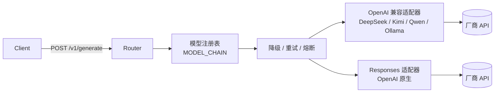

# llm-gateway

统一管理各厂商模型 API 与本地 ollama 模型调用的网关。

对外只暴露**一个统一入口** `/v1/generate`，调用方不需要区分 chat completions
与 responses ；内部按模型注册表选择厂商、按降级链调度，并把两条上游协议的差异
收敛在适配层里。

## 环境与启动

本项目使用 Conda 环境 `agent-training`：

```sh
conda activate agent-training
pip install -r requirements-dev.txt
cp .env.example .env      # 填入真实 API Key
uvicorn src.main:app --reload
```

接口文档：http://127.0.0.1:8000/docs

> 配置缺失（如未填 `DEEPSEEK_API_KEY`、`MODEL_CHAIN` 里写了未注册的模型）会在
> **启动时**直接抛 `ConfigurationError`，不会等到第一个请求才失败。

## Docker 部署

镜像基于 `python:3.12-slim`，以非 root（uid 10001）运行，配置全部通过环境变量
注入，`.env` 不会被打进镜像（见 `.dockerignore`）。

```sh
cp .env.example .env            # 填入真实 API Key
docker compose up -d --build    # 构建并后台启动
docker compose logs -f gateway  # 观察启动日志
```

访问 http://127.0.0.1:8000/docs。宿主机端口用 `GATEWAY_PORT` 覆盖，
镜像 tag 用 `IMAGE_TAG` 覆盖：

```sh
GATEWAY_PORT=8080 IMAGE_TAG=0.2.0 docker compose up -d --build
```

不使用 compose 时：

```sh
docker build -t llm-gateway:latest .
docker run -d --name llm-gateway -p 8000:8000 \
  -v llm-gateway-data:/data \
  -e DATABASE_URL=sqlite:////data/llm_gateway.db \
  --env-file .env llm-gateway:latest
```

部署要点：

- **持久化**：提示词模板库默认落在命名卷 `gateway-data` 的 `/data` 下。`.env`
  里给本地开发写的 `sqlite:///./llm_gateway.db` 是相对路径，在容器里会指向只读的
  `/app`，所以 compose 用 `GATEWAY_DATABASE_URL` 单独覆盖容器内路径。
- **PostgreSQL**：镜像默认只装了 SQLite 所需驱动；改用
  `postgresql+psycopg://...` 前需要在 `requirements.txt` 里加上
  `psycopg[binary]` 重新构建。
- **多进程 / 多副本**：`MAX_CONCURRENT_REQUESTS` 是**进程内**计数，总上限约为
  `MAX_CONCURRENT_REQUESTS × UVICORN_WORKERS`；多副本部署时 SQLite 也不适用。
- **探针**：`/health` 是存活检查（镜像 `HEALTHCHECK` 用它），`/ready` 会检查
  数据库与模型注册表，未配置 `DATABASE_URL` 时返回 503，不适合做存活探针。
- **优雅停机**：容器内 uvicorn 为 PID 1，`docker stop` 的 SIGTERM 会让在飞请求
  （含 SSE）正常收尾，`stop_grace_period` 设为 20s。
- **反向代理**：需要信任 `X-Forwarded-*` 时追加
  `-e UVICORN_EXTRA_ARGS="--proxy-headers --forwarded-allow-ips=*"`。
- **本机 ollama**：compose 已加 `host.docker.internal:host-gateway`，容器内可直接
  用 `http://host.docker.internal:11434/v1` 作为 `OLLAMA_BASE_URL`。

## 架构



- 适配器只实现 `complete()` 与 `stream()` 两个方法，协议差异由 `translator` 负责；
- 新增一个 OpenAI 兼容厂商通常只需要在 `.env` 里加几行配置；
- 不做 chat → responses 的事件模拟：模型不支持就直接报错（见下文开关）。

## 配置（.env）

| 键 | 说明 |
| --- | --- |
| `MODEL_CHAIN` | 降级链，逗号分隔，靠前者优先，例如 `deepseek-chat,gpt-4o-mini` |
| `MAIN_MODEL` / `BACKUP_MODEL` | `MODEL_CHAIN` 为空时的兼容写法 |
| `ENABLE_RESPONSES_MODE` | 是否允许 responses 方式调用，默认 `false` |
| `MODEL_<ID>_PROVIDER` | 必填，对应 `<PROVIDER>_API_KEY` / `<PROVIDER>_BASE_URL` |
| `MODEL_<ID>_UPSTREAM` | 上游真实模型名，默认等于 `<ID>` |
| `MODEL_<ID>_MODE` | `chat`（默认）或 `responses` |
| `MODEL_<ID>_CAPS` | 能力位：`tools,vision,json_schema,stream_usage,strict_json` 或 `none`；`strict_json` 表示支持 OpenAI 严格 `json_schema`（约束解码） |
| `MODEL_<ID>_TIMEOUT` | 覆盖该模型的读超时（秒） |
| `MODEL_<ID>_MAX_TOKENS_FIELD` | 输出长度字段名，OpenAI 推理模型用 `max_completion_tokens` |
| `RETRY_MAX_ATTEMPTS` | 429 限流的最大尝试次数（含首次），默认 3 |
| `FIRST_TOKEN_TIMEOUT` / `IDLE_TIMEOUT` | 流式首包超时 / 事件间隔超时（秒） |
| `CIRCUIT_FAILURE_THRESHOLD` / `CIRCUIT_COOLDOWN` | 熔断阈值与冷却时间 |
| `MAX_CONCURRENT_REQUESTS` | 入口同时处理中的请求数上限（含 SSE 流），默认 10；超出返回 429，`0` 表示关闭 |
| `OVERLOAD_RETRY_AFTER` | 429 响应里 `Retry-After` 的建议等待秒数，默认 1 |
| `STRUCTURED_OUTPUT_ENABLED` | 结构化输出总开关，默认 `true`；关闭后请求带 `structured_output` 会被拒绝 |
| `SCHEMA_REPAIR_MAX_ATTEMPTS` | schema 校验失败后**除首次之外**的重试次数，默认 2（与 `RETRY_MAX_ATTEMPTS` 独立） |
| `SCHEMA_REPAIR_MAX_ERROR_CHARS` / `SCHEMA_REPAIR_MAX_OUTPUT_CHARS` | 回灌给上游的错误摘要 / 错误输出上限（字符） |
| `SCHEMA_MAX_BYTES` / `SCHEMA_MAX_DEPTH` | 请求 schema 的大小 / 嵌套深度上限，超限直接 400 |
| `SCHEMA_REPAIR_ON_LENGTH` | `finish_reason=length` 时是否仍重试，默认 `false` |
| `SCHEMA_SUM_USAGE` | 修复重试是否累加所有尝试的 `usage`，默认 `true` |
| `SCHEMAS_DIR` | 具名 schema 注册表目录（`<schema_id>.json`），默认 `schemas` |
| `DATABASE_URL` | 提示词模板存储的 SQLAlchemy URL，默认空（未配置）：`sqlite:///./llm_gateway.db` / `postgresql+psycopg://user:pw@host/db` |
| `PROMPT_MAX_BYTES` | 单个模板正文的字节上限，默认 262144（256KB） |
| `PROMPT_MAX_RENDERED_BYTES` | 渲染后文本的字节上限，默认 524288 |
| `PROMPT_MAX_PER_USER` | 每个用户的模板数量上限，默认 200 |
| `PROMPT_CACHE_TTL` | 模板读取的进程内缓存 TTL（秒），默认 30，0 表示关闭 |
| `PROMPT_CACHE_MAX_ENTRIES` | 进程内缓存条目上限，默认 512 |
| `PROMPT_CACHE_MAX_BYTES` | 进程内缓存正文总字节预算，默认 16MB |

模型 ID 中的 `-` 与 `.` 在环境变量里写作 `_`，例如 `gpt-4o-mini` →
`MODEL_GPT_4O_MINI_PROVIDER`。

## 接口

| 方法 | 路径 | 说明 |
| --- | --- | --- |
| POST | `/{api_version}/generate` | **统一入口**：流式 / 非流式，chat / responses 均由 `mode` 决定 |
| POST | `/{api_version}/chat/completions` | OpenAI 兼容入口（保留给现成 SDK） |
| POST | `/{api_version}/responses` | responses 兼容入口，**仅非流式**，需开启 `ENABLE_RESPONSES_MODE` |
| GET | `/{api_version}/models` | 注册表中的可用模型 |
| POST/GET | `/{api_version}/prompts` | 提示词模板创建 / 列表（列表只返回摘要，不含正文） |
| GET/PATCH/DELETE | `/{api_version}/prompts/{prompt_id}` | 模板详情 / 更新（正文变更生成新版本）/ 软删除 |
| GET | `/health` | 存活检查 |
| GET | `/ready` | 就绪检查（数据库 + 模型注册表） |

三个会打到上游模型的入口（`generate` / `chat/completions` / `responses`）统一受并发限流保护：
同时处理中的请求数（**含整条 SSE 流**）超过 `MAX_CONCURRENT_REQUESTS` 时直接返回 **429**，
响应体 `error.code = gateway_concurrency_limited` 并带 `Retry-After`；`/health`、`/ready`、
`/{api_version}/models` 不受影响。

### 统一入口示例

所有请求必须携带 `X-User-Id` 请求头作为客户端唯一标识。缺失或非法时直接返回
**401**（`error.code` 为 `missing_user_id` / `invalid_user_id`），不会触到上游，也不会计入并发限流之外的任何调用。

```jsonc
// 非流式
POST /v1/generate
X-User-Id: user-123
{
  "model": "deepseek-chat",   // 可省略，省略时使用 MODEL_CHAIN 首位
  "mode": "auto",             // auto | chat | responses
  "messages": [{"role": "user", "content": "你好"}]
}
```

> 当前只做「形状」校验（非空、长度 ≤128、无控制字符）：header 由调用方自行声明，
> **并不是可信凭证**。接入真实鉴权后应改为从 API key / JWT 中解析身份。
> 兼容入口 `/chat/completions`、`/responses` 的 `X-User-Id` 仍是可选的；
> 但一旦请求引用提示词模板（`prompt`），就必须提供，否则 401 `missing_user_id`。

也可以使用 responses 风格的输入：

```jsonc
{"input": "你好", "instructions": "你是一个简洁的助手", "stream": true}
```

响应中除正文外还带有真实调用信息，便于感知是否发生降级：

```jsonc
{
  "model": "deepseek-chat",          // 请求的逻辑模型
  "upstream_model": "gpt-4o-mini",   // 实际调用的上游模型
  "provider": "openai",
  "mode": "chat",
  "fallback": true,
  "output": {"text": "...", "finish_reason": "stop"},
  "usage": {"prompt_tokens": 1, "completion_tokens": 2, "total_tokens": 3}
}
```

同时返回响应头 `X-Gateway-Model` / `X-Gateway-Provider` / `X-Gateway-Mode` /
`X-Gateway-Fallback`。

## 结构化输出（非流式 JSON Schema 校验）

`generate` / `chat/completions` / `responses` 三个入口的非流式返回都支持
`structured_output`：先校验 JSON 是否符合给定 schema，不通过时把**错误输出 +
校验违例**回灌给模型重新生成，重试预算耗尽后返回明确的错误码。

```jsonc
POST /v1/generate
X-User-Id: user-123
{
  "input": "把这张发票转成结构化数据",
  "structured_output": {
    // 二选一：内联 schema，或引用服务端具名 schema（SCHEMAS_DIR/invoice.json）
    "schema": {
      "type": "object",
      "properties": {"name": {"type": "string"}, "price": {"type": "number"}},
      "required": ["name", "price"],
      "additionalProperties": false
    },
    // "schema_id": "invoice",
    "schema_name": "invoice",   // strict 模式下上游要求的名字
    "mode": "auto",             // auto | strict | json_object | prompt_only
    "max_repair_attempts": 2,    // 可覆盖 .env 的 SCHEMA_REPAIR_MAX_ATTEMPTS
    "on_invalid": "error"        // error（默认）| return_raw
  }
}
```

`mode` 决定下发方式：

| mode | 行为 | 前提 |
| --- | --- | --- |
| `auto`（默认） | 链内有 `strict_json` 能力则走严格模式，否则退化为 `json_object`，再退化为纯提示词 | — |
| `strict` | 只允许 `strict_json` 部署，`response_format.json_schema.strict=true`；不发提示词副本 | 至少一个候选模型声明 `strict_json` |
| `json_object` | 下发 `{"type":"json_object"}`（Responses 协议为 `text.format`） | 至少一个候选模型声明 `json_schema` |
| `prompt_only` | 不下发任何 `response_format`，只把 schema 写进 system 提示词 | 无 |

与 OpenAI 原生字段的关系：`response_format` 仍然可用，但和 `structured_output`
**不能同时出现**（400 `invalid_request`）；一旦提供了 `structured_output`，网关
以它为准，并在能力不足时明确降级，而不是像以前那样静默丢弃 `response_format`。

校验重试的三个约定：

- 修复循环位于**降级层之上**：格式问题不会污染熔断计数；重试优先固定在上一次
  成功的部署，只有上游真报错时才降级；
- 回灌消息**始终基于原始消息重建**，不会随着重试次数线性膨胀；
- 重试预算与 `RETRY_MAX_ATTEMPTS`（限流退避）互相独立，避免成本相乘。

响应中除正文外会给出校验结果（`/generate`）：

```jsonc
{
  "output": {
    "text": "{\"name\": \"Widget\", \"price\": 9.9}",
    "json": {"name": "Widget", "price": 9.9},
    "schema_valid": true,
    "attempts": 2
  },
  "structured": {"schema_name": "invoice", "mode": "json_object",
                 "valid": true, "attempts": 2},
  "usage": {"prompt_tokens": 20, "completion_tokens": 30, "total_tokens": 50}
}
```

兼容入口保持协议原样：`chat/completions` 的 `content` 仍是字符串，
`responses` 的 `output` 仍是 `output_text`，校验摘要放在 `x_gateway.structured`；
三个入口都会返回 `X-Gateway-Schema-Mode` / `X-Gateway-Schema-Valid` /
`X-Gateway-Schema-Attempts` 响应头。

错误码：

| 状态 | `error.code` | 含义 |
| --- | --- | --- |
| 400 | `invalid_output_schema` | schema 本身不合法 / 过大 / 过深 / `schema_id` 未注册 |
| 400 | `unsupported_structured_output` | 报告的 `mode` 超出候选模型能力，或结构化输出已关闭 |
| 400 | `invalid_request` | `structured_output` 与 `response_format` 冲突，或用在流式请求上 |
| 502 | `output_schema_validation_failed` | 预算内始终产不出合规输出，`error` 里带 `attempts` / `violations` / `finish_reason` |

> `finish_reason=length`（输出被截断）默认**不重试**：同样预算下重试大概率还是
> 截断，应先调大 `max_tokens`。需要时用 `SCHEMA_REPAIR_ON_LENGTH=true` 打开。
>
> 校验使用 JSON Schema **draft 2020-12** 的结构约束；`format` 关键字默认不强制
> （未启用 format checker），需要格式约束请改用 `pattern` / `enum` / `minimum` 等。

### 流式事件（SSE）

统一入口使用与协议无关的事件信封：

```
event: delta
data: {"type": "delta", "text": "你"}

event: done
data: {"type": "done", "model": "deepseek-chat", "provider": "deepseek",
       "upstream_model": "deepseek-chat", "fallback": false,
       "finish_reason": "stop", "usage": {...}}

event: error
data: {"type": "error", "code": "upstream_timeout", "message": "...", "retryable": true}
```

## 降级策略

| 上游错误 | 行为 |
| --- | --- |
| 连接失败 / 超时 / 5xx | 降级到下一个候选模型 |
| 429 | 同一模型指数退避重试，最多 3 次，仍失败再降级 |
| 400 / 401 / 403 | **不降级**，直接返回（换模型只会掩盖配置或参数问题） |
| 内容审核拒答 | **不降级**，避免重复计费 |

补充约定：

- 连续失败达到阈值会触发熔断，冷却期内直接跳过该模型；
- **流式响应一旦发出首个事件就不再降级**，改为下发 `event: error`；
  首包之前的失败仍会返回真实的 HTTP 错误码；
- 降级前会按目标模型的能力位裁剪 `tools` / `response_format` 等参数；
- 结构化输出的校验重试独立于上表：它在降级层之上运行，只对“格式不合规”重试，
  不会因为格式问题把模型熔断；
- 流式调用的首包与事件间隔分别受 `FIRST_TOKEN_TIMEOUT` / `IDLE_TIMEOUT` 约束。

## 提示词模板（上传 → 渲染 → 注入）

用户可以把长文本模板存到网关，然后在三个会打上游的入口（`/generate`、
`/chat/completions`、`/responses`）里通过 `prompt` 引用，渲染结果注入 system 消息
（或首条 user 消息），从而让多个模型共用同一份模板。

模板正文与版本**分表保存**（`prompt_templates` + `prompt_template_versions`）：
修改正文会生成新版本，旧版本仍可按 `version` 引用，保证同一请求重放时结果可复现。

### 1. 上传模板

```jsonc
POST /v1/prompts
X-User-Id: user-123
{
  "name": "reviewer",
  "content": "你是一名 {{role}}。\n要求：{{requirements}}",
  "description": "代码评审人格",
  "variables": ["role", "requirements"]   // 可省略，上传时自动解析
}
```

返回 201：`id`（`ptpl_...`）、`version`、`content_hash`、`variables`、`token_estimate`。
占位符写作 `{{name}}`；单个 `{` `}` 原样保留，提示词里可以直接写 JSON 示例。

### 2. 查询

```jsonc
GET /v1/prompts?limit=20&offset=0&enabled=true   // 摘要列表，不含正文
GET /v1/prompts/{prompt_id}                       // 详情（含正文）
GET /v1/prompts/{prompt_id}?version=1             // 指定历史版本
PATCH /v1/prompts/{prompt_id}                     // 更新；expected_version 做乐观锁
DELETE /v1/prompts/{prompt_id}                    // 软删除，名称可复用
```

### 3. 在三个入口引用

```jsonc
POST /v1/generate
X-User-Id: user-123
{
  "input": "帮我评审这段代码",
  "prompt": {
    "id": "ptpl_...",
    "version": 1,          // 可选：固定版本，便于复现
    "variables": {"role": "资深代码评审员", "requirements": "只关注正确性"},
    "target": "system",    // system | instructions | user
    "position": "prepend", // prepend | append
    "on_missing": "error"  // error | empty
  }
}
```

模板即 system 提示：请求里**不能同时**提供 `instructions`，`messages` / `input` 里
也不能再带非空的 `role=system` 消息，否则返回 400 `prompt_instructions_conflict`。
这是刻意为之——不同厂商对「多条 system 消息」的处理不一致（按顺序拼接 / 只取第一条 /
直接 400），网关要求 system 提示只有一个来源，保证上游始终只收到一条 system 消息。
存在结构化输出时，最终顺序为 **模板 → 结构化 schema 约束 → 对话**；模板在最前面
也利于命中上游的 prompt cache。响应头会带回
`X-Gateway-Prompt-Id` / `X-Gateway-Prompt-Version` / `X-Gateway-Prompt-Bytes`，
日志只记 id / 版本 / 哈希 / 字节数，**不记录正文与变量值**。

### 4. 约束与错误码

- **`prompt` 与 system 内容互斥**：同时传 `prompt` 和 `instructions`，或在
  `messages` / `input` 里带非空 `role=system` 消息，一律 400
  `prompt_instructions_conflict`；`error.conflict_source` 会指出冲突来源
  （`instructions` / `messages` / `input`）。要复用原 system 提示，请把它的内容
  并入模板正文；
- 变量 key 必须是模板声明过的（拼写错误直接 400，不会静默忽略）；
- `variables` 值支持字符串、数字、布尔、null、数组/对象（容器按紧凑 JSON 序列化），
  其它类型 400；
- `target=user` 会写入首条 user 消息；请求里没有 user 内容时 400；
- 模板正文、渲染结果、每用户模板数量都有上限（见上表配置）；
- 模板属于某个 `user_id`，他人访问一律 **404**（不返回 403，避免探测存在性）。

| code | HTTP | 含义 |
| --- | --- | --- |
| `prompt_not_found` | 404 | 模板不存在或不属于当前用户 |
| `prompt_disabled` | 409 | 模板已停用 |
| `prompt_template_invalid` | 400 | 正文为空 / 占位符过多 |
| `prompt_variables_invalid` | 400 | 变量缺失、多余或类型不支持 |
| `prompt_render_failed` | 400 | 注入目标不存在（例如 target=user 但没有 user 消息） |
| `prompt_instructions_conflict` | 400 | 同时使用了 `prompt` 与 `instructions` / system 消息 |
| `prompt_too_large` | 413 | 正文或渲染结果超限 |
| `prompt_name_conflict` | 409 | 同一用户下名称重复 |
| `prompt_quota_exceeded` | 409 | 模板数量达到上限 |
| `prompt_version_conflict` | 409 | 乐观锁冲突 |
| `prompt_store_unavailable` | 503 | 未配置 `DATABASE_URL` 或数据库不可用 |

> 多 worker 部署时，模板缓存是**进程内**的：更新后其他 worker 最多在
> `PROMPT_CACHE_TTL` 秒后生效。需要强一致时请把 TTL 设为 0。

## 目录结构

```
src/
  app.py                      # 应用装配（注入配置、注册错误处理）
  main.py                     # uvicorn 入口
  config.py                   # Settings + .env 原始键读取
  schemas.py                  # 对外契约
  routes/
    generate.py               # 统一入口
    chat.py / responses.py    # 兼容入口
    _sse.py                   # SSE 响应构造（先取首事件再决定状态码）
    deps.py / models.py / health.py / prompts.py
  services/llm_adaptor/
    types.py                  # 内部 IR
    base.py                   # 能力位、部署描述、适配器协议
    errors.py                 # 错误分类与 HTTP 映射
    registry.py               # MODEL_<ID>_* → 部署；候选链解析
    failover.py               # 降级 / 429 退避 / 熔断
    structured.py             # JSON 提取、schema 校验、修复消息构造
    translator.py             # 协议翻译 + SSE 编码
    gateway.py                # 统一网关
    providers/
      openai_compat.py        # 所有 OpenAI 兼容厂商
      openai_responses.py     # 原生 Responses API
  services/prompts/
    render.py                 # {{var}} 解析 / 渲染（纯函数）
    store.py                  # SQLAlchemy Core 持久化（SQLite / PostgreSQL）
    service.py                # 校验、配额、缓存、版本
    inject.py                 # 渲染进 GenerateRequest（建流之前）
```

## 测试

```sh
python -m pytest -q
```

测试全部离线（`httpx.MockTransport` 打桩上游），覆盖降级、429 退避、不可重试
错误、流式中断不降级、responses 开关与启动期配置校验，结构化输出的
校验 / 修复重试 / 能力降级 / 错误码，以及提示词模板的 CRUD、版本、隔离性
与三个入口的渲染注入（存储用内存 SQLite）。


